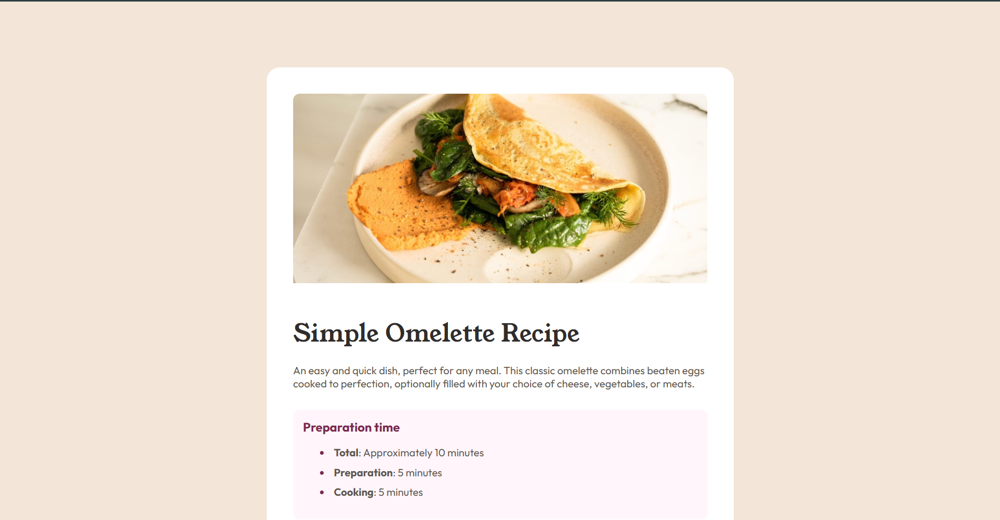

# Frontend Mentor - Recipe Page Solution

This is my solution to the [Recipe Page challenge](https://www.frontendmentor.io/challenges/recipe-page-KiTsR8QQKm) on Frontend Mentor.

## Overview

### Screenshot

### Links

- Live Site URL: [Live URL](https://98dinesh89.github.io/Frontend-Mentor-Recipe-page/)

## My Process

### Built With

- HTML5
- CSS3
- CSS custom properties
- Flexbox
- Semantic HTML

### What I Learned

While building this project, I learned how to:

- Use HTML to structure a webpage.
- Use CSS to style cards, lists, and tables.
- Use custom fonts with `@font-face`.
- Use CSS variables to manage colors.
- Match a design using spacing, margins, and padding.

### Continued Development

I want to improve my CSS skills and learn more about responsive design while building more projects.

### AI Collaboration

I used ChatGPT to help me understand CSS properties, debug styling issues, and improve the layout of my webpage.

## Author

- Frontend Mentor: [Dinesh](https://www.frontendmentor.io/profile/98Dinesh89)
